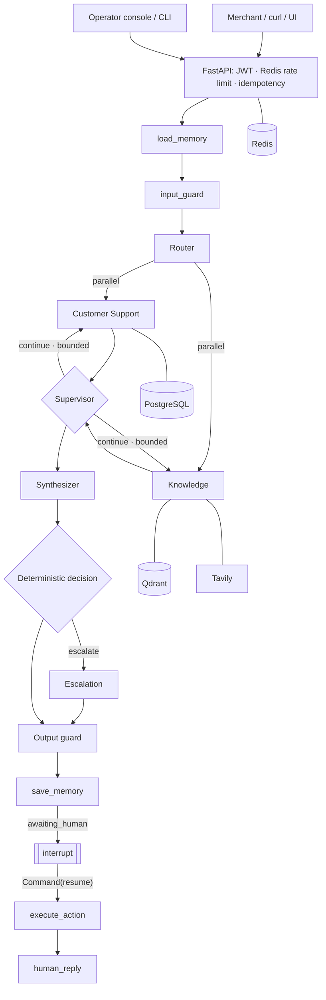

# Getnet Multi-Agent Support System

[](https://github.com/ArturFBrandi/ai-hardcore-engineer-v2/actions/workflows/ci.yml)

Multi-agent customer support for Getnet merchants: a **LangGraph** state machine where a Router, a Supervisor with
bounded replanning, a Knowledge agent (hybrid RAG over official Getnet content + web search), a Customer Support
agent (typed tools over a synthetic backend), a Human Escalation agent with a real **interrupt → human → resume**
loop and a Response Synthesizer cooperate. **MiniMax-M3** is the only reasoning LLM. Everything runs with Docker.

> 🎥 **Video walkthrough:** _link to be added at submission_ · script: [`docs/VIDEO_SCRIPT.md`](docs/VIDEO_SCRIPT.md)

## 5-minute evaluator path

```bash
git clone https://github.com/ArturFBrandi/ai-hardcore-engineer-v2 && cd ai-hardcore-engineer-v2
sudo ./scripts/bootstrap-ubuntu.sh        # fresh Ubuntu 26.04: Docker Engine + Compose plugin (official repo) + uv
cp .env.example .env                      # add MINIMAX_API_KEY (and WEB_SEARCH_API_KEY for weather/FX)
make verify                               # build → start → migrate → seed → snapshot corpus → smoke → all suites → eval --strict
make up                                   # (re)start the stack with MiniMax-M3 from .env
```
Then open **http://localhost:8000/ui** (customer chat; "Sign in" mints a dev token) and **http://localhost:8000/operator**
(operator console), and follow the demo: `make demo-scenarios` (the 10 challenge questions in PT+EN) and
`make demo-conversation` (memory across an API restart → supervisor dependency → escalation → operator reply → customer
receives it). `make verify` prints a summary table; reports land in `evaluation/results/`.

## Contents
1. [Overview](#1-overview) · 2. [Architecture](#2-architecture) · 3. [The central principle](#3-the-central-principle) ·
4. [Agents](#4-agents) · 5. [Workflows](#5-message-workflows) · 6. [RAG pipeline](#6-rag-pipeline) · 7. [MiniMax-M3](#7-minimax-m3-integration) ·
8. [Tools & action policy](#8-customer-tools-and-action-policy) · 9. [Synthetic data](#9-synthetic-data) · 10. [Memory](#10-conversation-memory) ·
11. [Human in the loop](#11-human-in-the-loop) · 12. [Identity & auth](#12-identity-and-auth) · 13. [Quick start](#13-quick-start) ·
14. [Fresh Ubuntu 26.04](#14-fresh-ubuntu-2604-installation) · 15. [Configuration](#15-configuration) · 16. [Testing](#16-testing) ·
17. [Evaluation](#17-evaluation) · 18. [Observability](#18-observability-and-cost) · 19. [Security & guardrails](#19-security-and-guardrails) ·
20. [Reliability](#20-reliability) · 21. [Performance & cost](#21-performance-and-cost-per-workflow) · 22. [Limitations](#22-limitations) ·
23. [Production evolution](#23-production-evolution) · [Docs index](#docs-index)

## 1. Overview

| Requirement | Implementation |
|---|---|
| ≥3 agent types + communication | 6 LangGraph nodes acting as agents + deterministic nodes; typed shared state with reducers; parallel supersteps ([ARCHITECTURE](docs/ARCHITECTURE.md)) |
| Router | rules → MiniMax structured output → deterministic fallback; code derives the agent list (`app/agents/router.py`, `app/orchestration/routing.py`) |
| Knowledge (RAG + web) | Qdrant dense + BM25 + RRF + cross-encoder rerank over 150 official pages/PDFs (925 chunks); Tavily for current facts |
| Customer Support (≥2 tools) | 7 read-only tools + 1 approval-gated action + idempotent case creation, scoped to the verified customer |
| API | `POST /v1/chat` with the exact payload `{"message", "user_id"}` (+ optional `conversation_id`) |
| Docker | multi-stage non-root image, Compose stack (api, worker, migrate, models-init, postgres, qdrant, redis) + profiles |
| Testing | 191 offline tests in 6 suites + 10 E2E/scale tests against the composed stack + 5 live-provider tests; evaluation harness; CI on every push |
| Bonus | 4th agent (Human Escalation) with interrupt/resume + approvals, layered guardrails, human handoff, evaluation + observability stack |

## 2. Architecture


Modular monolith (ADR 002): one image with roles `api`, `worker`, `migrate`, `seed`, `models`, `snapshot`, `ingest`.
Details, trust boundaries and failure behaviour: [`docs/ARCHITECTURE.md`](docs/ARCHITECTURE.md).

## 3. The central principle

> **The LLM proposes, deterministic code disposes.**

| Concern | MiniMax-M3 proposes | Code decides |
|---|---|---|
| Routing | intent, flags, standalone PT query, plan steps | high-confidence rules first; Pydantic validation; **agent list derived from intent**; invalid output → deterministic fallback (`route_source=fallback`) |
| Planning | step list with dependencies | allowed agents/transitions, step cap, no duplicates, dependencies point backwards, token budget; else deterministic plan |
| Supervision | next step only when results are ambiguous | dependencies, triggers (model filter, decline code, broadened retry, transient retry, contradiction), visit/step/recursion budgets |
| Tools | which read tools to call and with which args | typed validation, customer scope, least-privilege matrix, policy table, coverage guard |
| Answers | wording, combination | evidence-only grounding, citation verification, numbers must exist in evidence/tool data, canary/redaction |
| Memory | rolling summary text | window size, slots extracted from tool results, expiry on topic switch, redaction, TTL, erasure |
| Escalation | category/subject/summary | confidence from system signals (YAML penalties), forced reasons, priority & SLA, case creation |
| Approvals | that an action may help | `requires_approval` policy; executes only after operator approval, with the case owner's identity |
| Identity / auth | — (never) | JWT `sub` (or demo `user_id`), scopes, ownership checks, thread id built server-side |

## 4. Agents

| Agent | Responsibility | Tools / powers | Prompt |
|---|---|---|---|
| Router | classify intent (14 intents), detect human request, resolve follow-ups, PT query rewrite, plan proposal; never answers | none | `app/agents/prompts/router.md` (few-shots, PT/EN) |
| Supervisor | after each superstep: continue / synthesize / escalate within budgets | none | `supervisor.md` |
| Knowledge | Getnet mode (RAG authoritative) or external mode (web); grounded answer with `[E#]` citations | retriever, web search | `knowledge_rag.md`, `knowledge_web.md` |
| Customer Support | bounded tool loop over the merchant's data; may propose a terminal replacement | 7 read tools + proposal | `customer_support.md` |
| Human Escalation | categorize, summarize sanitized context, create case, handoff; `interrupt()` | `create_support_case`, interrupt | `escalation.md` |
| Synthesizer | one coherent answer in the customer's language; pass-through when a single grounded answer exists | none | `synthesizer.md` |
| (human reply) | turn operator notes into a customer message grounded only on them | none | `human_reply.md` |

## 5. Message workflows

Sequence diagrams for Workflows 1–6 (settlement in parallel, troubleshooting with supervisor dependency, external
information, multi-turn escalation, HITL reply, approval) are in [`docs/ARCHITECTURE.md §3`](docs/ARCHITECTURE.md#3-message-workflows).
Traces of Workflows 1 and 2: [`docs/observability/`](docs/observability/).

## 6. RAG pipeline

**Ingestion** (`make ingest`): `ingestion/sources.yaml` (seeds on `site.getnet.com.br` and `www.getnet.net/en`, allow/deny
rules, categories/products, 4 official PDF manuals, 74 JS-discovered Get Ajuda articles) → polite crawler (robots.txt,
per-host rate limit, timeouts, content types, ETag/Last-Modified) → HTML extraction (removes nav/footer/pop-ups/scripts/
comments; keeps headings, paragraphs, tables, numbered procedures and FAQ Q/A pairs from modal markup) or PDF extraction
(page sections, re-joined lines) → cross-page boilerplate removal → **structure-aware chunking** (H1–H3, FAQ entry =
1 chunk, procedures/tables atomic, ≈900 chars, max 1,600, heading path prefix) → metadata (`url, canonical_url, title,
heading, category, product(s), language, source, retrieved_at, content_hash, etag, last_modified`) → body-hash dedup →
**dense (MiniLM-L12, 384-d, cosine) + sparse (BM25-PT)** → Qdrant named vectors.
Last crawl: **150 pages (146 HTML + 4 PDF) → 925 chunks**; JS rendering is an optional profile (`make render-ingest`).

**Storage / snapshot**: `make snapshot-export` writes `data/snapshots/getnet-kb.jsonl.gz` (250 KB, sha256 manifest, committed
for reproducibility); `make ingest-snapshot` re-embeds it with the configured models.

**Retrieval**: 15 RRF candidates (Qdrant Query API, filters applied inside Qdrant; product filter = model OR generic) →
dedup → **jina-reranker-v2 multilingual on the top 8** (700 chars) → `RAG_RERANK_MIN_SCORE=-0.8` → 5 evidence passages.

**Generation**: evidence is delimited as `<retrieved_evidence untrusted="true">`; the model must cite `[E#]`; code keeps
only cited ids that were given; numbers must appear in evidence (one stricter regeneration, then extractive fallback).
No evidence → "I couldn't find verified information…", never model memory.

**Model choice by measurement** (ADR 006, `evaluation/results/retrieval_benchmark.md`, 66 golden questions):

| Dense (dim) | hybrid Recall@5 | + rerank Recall@5 / MRR@10 | index time |
|---|---:|---:|---:|
| **MiniLM-L12 (384)** — default | 0.833 | 0.894 / 0.841 | 33 s |
| mpnet-base (768) | 0.864 | 0.909 / 0.858 | 261 s |
| e5-large (1024) — "quality" option | 0.848 | 0.939 / 0.868 | ≈11 min |
| potion (256) | 0.788 | 0.833 / 0.799 | 25 s |

Hybrid beats dense (0.818) and BM25 (0.636) alone. Reranking the top 8 keeps Recall@5 while cutting rerank p50 from ≈3 s
to 1.16 s (`rerank_budget.md`). **Calibration** (`make calibrate`, `calibration.md`): threshold −0.8 → F1 0.906
(precision 0.936, recall 0.879) against 12 out-of-domain negatives. In-process eval on the deployed configuration:
Recall@5 0.894, MRR@10 0.846.

## 7. MiniMax-M3 integration

OpenAI-compatible Chat Completions at `https://api.minimax.io/v1` via the `openai` SDK, behind `LLMProvider`
(`app/llm/base.py`): `MiniMaxProvider` (production) and `FakeLLMProvider` (tests; refused in production).
Verified live (ADR 004): `tools`/`tool_calls` round-trips; `response_format=json_object` works but `json_schema` is
ignored → schemas are enforced by Pydantic with one repair round; thinking is on by default and appears as `<think>` in
`content` → requests send `thinking: {type: disabled}` and think blocks are stripped. Retries only on
408/409/429/5xx/timeouts with jittered backoff; circuit breaker; per-request token budget; usage → tokens and cost metrics.
`make llm-test` checks plain completion, structured output and a tool round-trip (missing key → explicit instructions).

## 8. Customer tools and action policy

`LLM agent → typed tool (Pydantic) → customer-scoped repository → PostgreSQL` — the LLM never writes SQL.

| Tool | Policy | Holder |
|---|---|---|
| `get_customer_profile`, `get_customer_terminals`, `get_terminal_status`, `get_recent_transactions` (date presets resolved in the BR calendar), `get_transaction_details`, `get_settlement_schedule`, `get_open_support_cases` | `auto_allowed` (read) | Customer Support |
| `create_support_case` (idempotent per conversation + reasons; case + pending action + outbox + audit in one transaction) | `auto_allowed` (system path only) | Escalation |
| `request_terminal_replacement` (creates a service order) | `requires_approval` | proposed by Customer Support, executed after operator approval |
| `refund_transaction`, `change_bank_account`, `export_customer_data`, anything unknown | `forbidden` | — |

`AuthContext` is immutable, built from the verified principal, and flows unchanged to tools, memory and HITL resume.
Foreign and missing rows are indistinguishable (`not_found`).

## 9. Synthetic data

`app/db/seed.py` (idempotent, dates relative to the seeding moment in America/Sao_Paulo): `cliente1988` "Padaria Pão
Dourado" (Get Smart with recent connectivity losses + Get Mini; ~100 transactions incl. declines 51/05 and pending/refunded;
settlements completed/pending/scheduled with D+1 debit, D+2 credit, same-day Pix; one resolved and one in-progress case)
and `cliente2077` "Neon Motos" (isolation customer). Documents, cards and bank data are masked and labelled synthetic.

## 10. Conversation memory

Durable in PostgreSQL (`conversations`, `conversation_turns`, redacted) + LangGraph `AsyncPostgresSaver` checkpoints
(thread `customer:conversation`, server-built). Layers: window of 8 turns (untrusted delimiters), rolling MiniMax summary
over 1,800 tokens (truncation fallback; summaries never turn instructions into facts), deterministic slots
(`active_terminal_id/model`, `last_transaction_ids`, `last_date_range`, `open_case_id`, `preferred_language`,
`troubleshooting_attempts`, evidence already shown, `last_human_reply`) expiring on topic switch. Per-conversation
advisory lock serializes concurrent turns; `Idempotency-Key` (Redis, bound to the subject) replays responses;
`DELETE /v1/conversations/{id}` erases turns, summary and checkpoints; worker purges after `CONVERSATION_TTL_DAYS`.
Verified: coreference, carry-over + escalation on the 3rd failure, language persistence, restart between turns, two replicas, concurrency.

## 11. Human in the loop

Escalation → case (+ outbox notification) → handoff answer saved → `interrupt()`; the interrupt checkpoint id is stored
on the case. `POST /v1/operator/cases/{id}/reply` or `/decision` resumes **the same thread** with
`Command(resume=OperatorDecision)` → approved action executes with the case owner's identity → `human_reply` (MiniMax
rewrite grounded on the operator text, or verbatim) → `human_operator` turn → SSE to the customer → next turn knows it.
Priority/SLA deterministic (fraud → urgent; terminal down with no sales today or repeated failure → high; else normal);
worker bumps priority on SLA breach, re-notifies and tells the customer. Operator surfaces: `/operator` console,
`make operator ARGS="list|show|claim|reply|approve|reject|edit|resolve"`. Every step is in the append-only `audit_log`.

## 12. Identity and auth

`AUTH_MODE=jwt` (default): RS256 JWT verified against a JWKS; identity = `sub`; body `user_id` optional but must equal
`sub` (else **403**). `AUTH_MODE=demo` (refused in production): body `user_id` is the identity, exactly like the
challenge payload. Operators always use JWTs. Dev keys: `make keys`; tokens: `make token`.

```bash
# JWT mode (default)
TOKEN=$(make -s token SUB=cliente1988 SCOPE="chat conversations:read")
curl -s -X POST http://localhost:8000/v1/chat \
  -H "Authorization: Bearer $TOKEN" -H 'Content-Type: application/json' \
  -d '{"message": "When will the money from yesterday'\''s sales be deposited?", "user_id": "cliente1988"}'

# follow-up turn in the same conversation
curl -s -X POST http://localhost:8000/v1/chat \
  -H "Authorization: Bearer $TOKEN" -H 'Content-Type: application/json' \
  -d '{"message": "And the sales from the day before?", "conversation_id": "<id from previous response>"}'

# body user_id different from the token subject → 403
curl -s -X POST http://localhost:8000/v1/chat -H "Authorization: Bearer $TOKEN" \
  -H 'Content-Type: application/json' -d '{"message": "oi", "user_id": "cliente2077"}'

# AUTH_MODE=demo (development only): the exact challenge payload, no token
AUTH_MODE=demo docker compose up -d --wait api
curl -s -X POST http://localhost:8000/v1/chat -H 'Content-Type: application/json' \
  -d '{"message": "When will the money from yesterday'\''s sales be deposited?", "user_id": "cliente1988"}'
docker compose up -d --wait api   # back to jwt
```
Every command above was executed against the stack on 2026-10-19 (200 · 200 turn 2 · 403 · 200 in demo mode); the
full manual HTTP validation (20 challenge questions, 4-turn coreference across two API restarts, HITL reply, approval
approve/reject, 403/404, injection) passed in both modes on 2026-10-20.

## 13. Quick start

```bash
cp .env.example .env     # MINIMAX_API_KEY=..., WEB_SEARCH_API_KEY=...
make up                  # keys, docker compose up --wait, seed, load snapshot corpus
make smoke-test          # liveness, readiness, metrics, auth, seeded data, RAG citations
make demo-scenarios      # 10 challenge questions × PT/EN table
make logs | make down | make dev-reset (DESTRUCTIVE: deletes volumes)
```
Endpoints: `POST /v1/chat` · `GET /v1/conversations[/{id}[/events]]` · `DELETE /v1/conversations/{id}` ·
`/v1/operator/cases…` · `GET /health/live|ready` · `GET /metrics` · `GET /v1/debug/traces/{request_id}` (dev) · `/docs` (dev).

## 14. Fresh Ubuntu 26.04 installation

`sudo ./scripts/bootstrap-ubuntu.sh [--user <name>]` checks the OS, installs prerequisites, Docker Engine + Compose
plugin **from download.docker.com** (removes conflicting distro packages; falls back to the noble suite if Docker has
not published one for 26.04 yet) and uv, then verifies (`docker run hello-world`). Idempotent, fail-fast, opens no ports.
Tested twice in a clean `ubuntu:26.04` container (locally and in CI). Then `cp .env.example .env && make verify`.

Scaling: `make scale-test` (2 replicas behind nginx on :8080), or the plain Compose form
`API_PORT=8000-8001 docker compose --profile proxy up -d --scale api=2` — the single-replica stack keeps a fixed
port 8000, so the replicas need a port range ([ADR 014](docs/adr/014-scaling-command-and-published-port.md)).

## 15. Configuration

Every variable is documented, grouped and commented in [`.env.example`](.env.example) and validated by the typed
`Settings` (`app/config.py`): production refuses `AUTH_MODE=demo`, `LLM_PROVIDER=fake`, missing MiniMax key, file JWKS
and wildcard CORS, and force-disables debug endpoints; `safe_dict()` is the only way settings are logged.

## 16. Testing

| Command | Scope |
|---|---|
| `make test` | all offline suites (fake LLM, real PostgreSQL/Qdrant/Redis started via Compose) |
| `make test-unit` · `test-integration` · `test-orchestration` · `test-security` · `test-multiturn` · `test-hitl` | individual suites |
| `make test-e2e` · `make scale-test` | HTTP against the composed stack (restart, outages, HITL+SSE, demo auth) · 2 replicas behind nginx |
| `make test-docker` | offline suite inside the Dockerfile `test` stage |
| `make test-live` | real MiniMax-M3 / Tavily (skips with a message without keys) |
| `make coverage` | gate ≥ 85% of `app/` |

Latest run (2026-10-20, commit `e28b2b2`): **191 offline tests passed, 0 failed** (91 unit, 29 integration,
12 orchestration, 35 security, 11 multi-turn, 13 HITL); **9 E2E + 1 scale** passed against the stack (`make verify`,
`make scale-test`); **5 live** passed (`make test-live`); `make test-docker` 166 passed (the same offline suite in the
Dockerfile `test` stage; the docs-contract test checks only the README there); coverage **90.9%** (gate 85%). Strategy and how the
orchestration is integration-tested: [`docs/TESTING_GUIDE.md`](docs/TESTING_GUIDE.md).

## 17. Evaluation

`evaluation/`: 126 single-turn cases (10 challenge scenarios × PT/EN, golden knowledge questions, customer data,
troubleshooting, web, missing data, unknown customer, ambiguous, adversarial/encoded injections, cross-customer, JWT/body
mismatch, escalations), 17 multi-turn conversations, 7 HITL and 6 supervisor scenarios, and a **68-item golden factuality
benchmark** (atomic facts + hallucination traps, drafted from official sources, pending human confirmation —
[protocol](evaluation/golden/README.md)). Metrics are deterministic; thresholds in `evaluation/thresholds.yaml`;
`--strict` fails CI on regression; deltas vs `evaluation/results/baseline.json`.

```bash
make eval        # offline, deterministic (fake LLM) → evaluation/results/latest.{md,json}
make eval-live   # MiniMax-M3 + Tavily → evaluation/results/live-latest.{md,json}
```

**Offline (CI gate)** — measures the deterministic system; language/fluency is not meaningful with the test double:

| case pass | intent | routing | tools | escalation | guardrail block | false block | citation faithfulness | hallucination | multi-turn | HITL | supervisor | Recall@5 / MRR |
|---:|---:|---:|---:|---:|---:|---:|---:|---:|---:|---:|---:|---:|
| 0.976 | 0.991 | 0.991 | 1.000 | 0.991 | 1.000 | 0.000 | 1.000 | 0.000 | 1.000 | 1.000 | 1.000 | 0.894 / 0.846 |

<!-- LIVE_RESULTS_START -->
**Live (MiniMax-M3 + Tavily, 2026-10-20, commit `e28b2b2`, concurrency 2, 1,308 s, strict gate PASS)** —
`evaluation/results/live-latest.md`:

| case pass | intent | routing | tools | escalation | guardrail block | false block | citation presence / faithfulness | claim recall | hallucination | answer language | multi-turn | carry-over | HITL | supervisor |
|---:|---:|---:|---:|---:|---:|---:|---:|---:|---:|---:|---:|---:|---:|---:|
| 0.976 | 0.973 | 1.000 | 1.000 | 1.000 | 1.000 | 0.000 | 1.000 / 1.000 | 0.887 | 0.000 | 0.991 | 0.941 | 1.000 | 1.000 | 0.833 |

Latency p50 5.8 s / p95 30.3 s; 2.7 LLM calls, 5,901 tokens and **$0.0022** per case on average. Live misses: three
intent labels where MiniMax chose `customer_settlement` over `customer_transaction`/`getnet_how_to` (routing is still
correct: both use the same specialists), one multi-turn turn with the same confusion, and one supervisor scenario where
the LLM supervisor was consulted once although the deterministic result was already sufficient. History: the first
live run (2026-10-19) scored HITL 0.71 and exposed bugs fixed since (listed in `docs/PROGRESS.md`, phase 16–17).
<!-- LIVE_RESULTS_END -->

LLM judge (optional, probabilistic, not a gate): MiniMax-M3 at temperature 0 on 30 labeled answers → accuracy 1.000,
Cohen's κ 1.000 — an upper bound, since the calibration pairs are clear contrasts with draft labels
(`evaluation/results/judge_calibration.md`).

## 18. Observability and cost

Structured JSON logs (structlog) carry `request_id` and the OTel `trace_id`/`span_id` (one id space — the same id is
returned in the response, the `traceparent` header and the debug trace). OTel spans per node (`agent.*`), tool
(`tool.*`), retrieval stage (`rag.embed/vector_search/rerank`), web search and LLM call (`llm.<task>`). 30+ Prometheus
metrics with low-cardinality labels (routes by source, supervisor decisions, tool calls/failures, RAG no-results,
escalations by reason, HITL queue/SLA, approvals, LLM tokens/cost/latency, breaker state, guardrail triggers, auth
failures, rate limiting). `make observability-up` starts OTel Collector + Jaeger + Prometheus + Grafana with a
provisioned 20-panel dashboard and 9 alert rules ([`docs/observability`](docs/observability/), [`docs/SLO.md`](docs/SLO.md)).
Cost per request = tokens × `LLM_PRICE_*` (MiniMax-M3: $0.30/M in, $1.20/M out), returned in the response
(`token_usage`), the debug trace and `agent_request_cost_usd`.

## 19. Security and guardrails

Threat model with STRIDE and the OWASP LLM Top 10 (2025) mapped to controls and test files: [`docs/THREAT_MODEL.md`](docs/THREAT_MODEL.md).
Layers: **input** (NFKC, confusables, zero-width, base64, leetspeak; injection, prompt extraction, cross-customer, bulk
dump/SQL, credential and harmful-request rules; multi-turn split injection), **retrieval** (untrusted evidence blocks,
citation verification), **tool** (least privilege, scope, policy, approvals, bounded loops), **output** (canary block,
redaction, internal markup, numeric grounding), **memory** (redaction before storage, untrusted history). Attack
traffic never auto-opens human cases. `make security`: pip-audit (0 known vulnerabilities), Bandit (no Medium/High),
gitleaks (history clean), Trivy (0 fixable HIGH/CRITICAL) — failing on findings; SBOM via syft.

## 20. Reliability

Timeouts everywhere (LLM 45 s, web 15 s, DB statements 10 s, Qdrant 10 s, Redis 2 s, tools 5 s, request 120 s); retries
only for retryable errors with jittered backoff; circuit breakers for MiniMax and Tavily (metric); bounded tool rounds (4),
supervisor steps (3), visits per agent (3), recursion limit (40), token budget (40k/request). Degradation: web down →
honest "unavailable"; RAG down → never answers Getnet facts from memory; MiniMax down → rule/fallback routing,
coverage-guard tools, deterministic answers and escalation; PostgreSQL down → 503; Redis down → documented policy.
Outbox retries with backoff and dead-letters; graceful shutdown (60 s) drains in-flight requests.

## 21. Performance and cost per workflow

<!-- PERF_START -->
Measured in the final live evaluation (MiniMax-M3, 2026-10-20, 126 single-turn cases grouped by routed intent;
CPU-only host, concurrency 2):

| workflow | cases | p50 latency | p95 latency | LLM calls (mean) | tokens (mean) | USD per request (mean) |
|---|---:|---:|---:|---:|---:|---:|
| Getnet knowledge (RAG) | 60 | 5.8 s | 13.4 s | 2.0 | 3,644 | $0.0013 |
| customer data (tools) | 16 | 11.6 s | 29.9 s | 5.1 | 11,517 | $0.0042 |
| blocked by guardrail | 15 | 0.1 s | 0.1 s | 0.0 | 0 | $0.0000 |
| troubleshooting (Workflow 2) | 11 | 21.2 s | 38.3 s | 7.0 | 15,953 | $0.0059 |
| external info (web) | 9 | 2.8 s | 11.3 s | 1.1 | 3,062 | $0.0011 |
| settlement (Workflow 1) | 8 | 14.8 s | 36.3 s | 6.1 | 15,798 | $0.0058 |
| unsupported / clarify | 4 | 0.9 s | 2.1 s | 0.5 | 978 | $0.0003 |
| human escalation | 2 | 2.3 s | 3.1 s | 1.0 | 672 | $0.0003 |

Cost uses MiniMax-M3 list prices ($0.30/M input, $1.20/M output tokens). CPU reranking is ≈1.1 s of every retrieval.
Troubleshooting p95 was 116 s before LLM-proposed supervisor steps were capped at one per turn
([ADR 010](docs/adr/010-supervisor-bounded-replanning.md): supervisor vs static fan-out measured live).
<!-- PERF_END -->

## 22. Limitations

- Live intent labels confuse `customer_settlement` with `customer_transaction` on "my sales yesterday" phrasing
  (2–3 of 126 cases per run); routing and tools are unaffected because both intents use the same specialists.
- Offline evaluation uses a deterministic test double for the LLM; it measures the deterministic system, not MiniMax
  quality (see the live results). Golden and judge labels are drafts pending human confirmation.
- CPU reranking dominates latency (~1 s per retrieval); a GPU or smaller reranker would cut it further.
- The default embedding model trades ~4.5 pp Recall@5 for a 10× smaller footprint (e5-large is a config switch).
- Getnet's site changes frequently; the snapshot is from 2026-10-19 and `make ingest` re-crawls incrementally. The Get Ajuda
  hubs need the JS render profile to discover new articles (known URLs are listed in `sources.yaml`).
- Rule-based injection detection is a first layer; structural controls (scoping, approvals, canary) are the real defence.
- The customer backend is synthetic; amounts/fees in it are not Getnet's real rates.
- Video link to be added at submission.

## 23. Production evolution

Real Getnet APIs behind the tool/repository seam (same `AuthContext` scoping); managed OIDC (JWKS URL) instead of the dev
IdP; secrets from a secrets manager; streaming responses over the existing SSE channel; canary evaluations (shadow
traffic through `make eval-live` gates before rollout); managed Postgres/Qdrant/Redis with backups (`pg_dump`, Qdrant
snapshots — `make snapshot-export` already versions the corpus); per-tenant rate limits and cost budgets.

## Docs index
[IMPLEMENTATION_PLAN](docs/IMPLEMENTATION_PLAN.md) · [ARCHITECTURE](docs/ARCHITECTURE.md) · [THREAT_MODEL](docs/THREAT_MODEL.md) ·
[SLO](docs/SLO.md) · [TESTING_GUIDE](docs/TESTING_GUIDE.md) · [VIDEO_SCRIPT](docs/VIDEO_SCRIPT.md) · [SCORECARD](docs/SCORECARD.md) ·
[ADRs](docs/adr/) · [PROGRESS ledger](docs/PROGRESS.md) · [challenge statement](docs/AI_Hardcore_Engineer-Multi-Agent_Support_System-Tech-Challenge.md)
