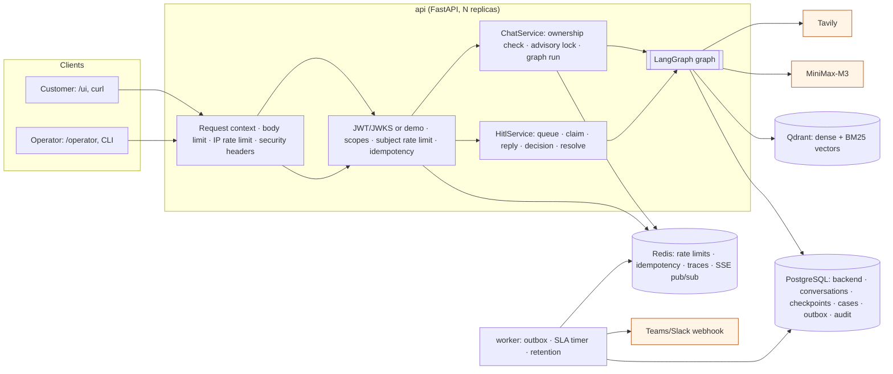
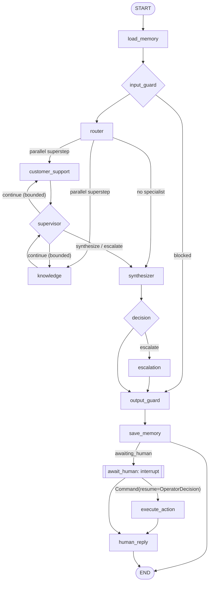
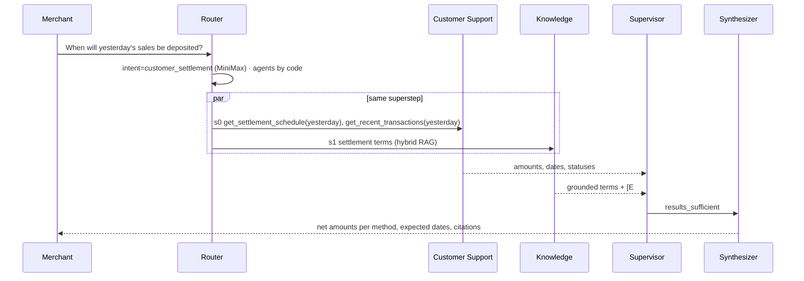
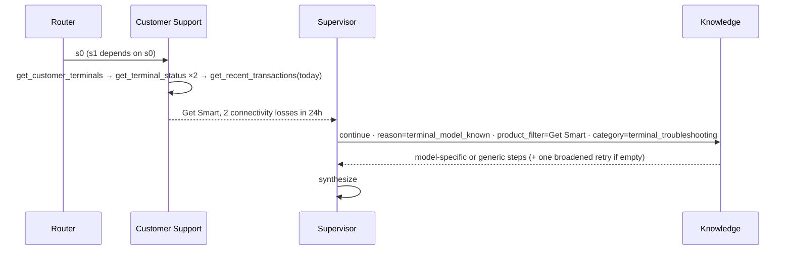
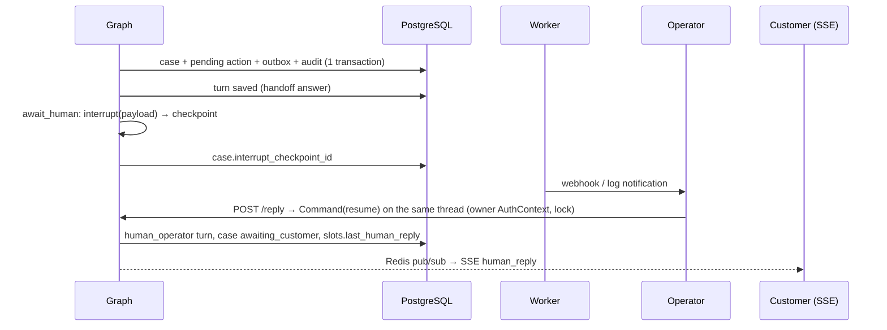

# Architecture

> Principle: **the LLM proposes, deterministic code disposes.** MiniMax-M3 interprets, plans and phrases; code owns
> identity, authorization, memory scope, state, tools, approvals, validation, reliability and security.

## 1. Components

One image, several roles (`docker/entrypoint.sh`): `api`, `worker`, `migrate` (Alembic + checkpointer `setup()`),
`seed`, `models` (models-init), `snapshot`, `ingest`. Optional profiles: `observability`, `proxy`, `render`.

## 2. The graph

| Node | Role | LLM? | Writes |
|---|---|---|---|
| load_memory | window, summary, slots (customer-scoped) | no | history, slots, language |
| input_guard | normalization + injection/extraction/cross-customer/dump/credential/harmful rules; multi-turn | no | guardrail_flags, blocked |
| router | rules → MiniMax structured output → deterministic fallback; code derives agents; plan validated | yes (when no rule) | intent, route, plan, active_steps |
| customer_support | bounded tool loop (≤4 rounds) + deterministic coverage guard | yes | tool_results, proposed_actions |
| knowledge | Getnet RAG (authoritative) or web search; grounded generation, citation & numeric checks | yes | retrieved_documents, knowledge_answers |
| supervisor | dependencies, triggers, optional validated LLM proposal, budgets | rarely | plan, active_steps |
| synthesizer | combine data + evidence in the customer's language; pass-through when single grounded answer | yes (multi-source) | candidate_answer, citations |
| decision | deterministic confidence, escalation, priority | no | confidence, needs_escalation, priority |
| escalation | categorize/summarize (LLM, validated), create case, handoff | yes (fallback exists) | case_id, status |
| output_guard | canary, redaction, internal-markup, language | no | final_answer |
| save_memory | turns, slots, summary trigger, SSE publish | summary only | slots |
| await_human / execute_action / human_reply | HITL interrupt, approved action with owner context, operator message | human_reply only | operator_decision, action_result |

## 3. Message workflows

### Workflow 1 — settlement (parallel cooperation)

### Workflow 2 — troubleshooting (supervisor-driven dependency)

### Workflow 3 — external information
Router rule `exchange_rate`/`weather` → Knowledge (web mode) → Tavily → answer with source and retrieval time; search
down → "I cannot retrieve current external information right now" (no case; `web_search_failure` penalty 0).

### Workflow 4 — multi-turn troubleshooting → escalation
Turn 1 diagnosis + steps (slots: `active_terminal_model`, `troubleshooting_attempts.connectivity=1`, evidence used) →
turn 2 "já reiniciei e continua" (slot-based query rewrite, unseen steps, attempts=2) → turn 3 failure report →
`repeated_troubleshooting_failure (3 attempts)` → case + interrupt.

### Workflow 5 — HITL reply

### Workflow 6 — approval
Customer Support calls `request_terminal_replacement` → registry returns `approval_required` (not executed) →
decision forces escalation (`approval_required`) → interrupt kind `approval` → operator `approve | reject | edit` →
`execute_action` runs `ToolRegistry.execute_approved` with the **case owner's** context (a foreign terminal in edited
arguments is simply not found) → `human_reply` explains the outcome.

## 4. Trust boundaries and permissions

| Boundary | Untrusted input | Control |
|---|---|---|
| Customer → API | message, body `user_id`, headers | JWT/JWKS, scopes, body/sub mismatch 403, size limit, rate limits, input guardrails |
| Operator → API | replies, decisions, edited args | operator scopes, case-owner AuthContext, audit, stricter fail-closed rate limit |
| API → MiniMax | prompts contain untrusted history/evidence | delimiters, canary, structured output validation, budgets, breaker |
| Web/crawled content | evidence & search results | `untrusted="true"` blocks, citation verification, numeric grounding |
| Memory | prior turns, summaries | redaction before storage, untrusted delimiters, multi-turn injection detection |

| Agent | Tools / powers |
|---|---|
| Router, Supervisor, Synthesizer | none |
| Knowledge | `rag_search` (retriever), `web_search` |
| Customer Support | 7 read-only tools; may PROPOSE `request_terminal_replacement` |
| Escalation | `create_support_case` (system path), `interrupt` |
| Operator (human) | reply, approve/reject/edit, resolve — only on the case owner's data |

## 5. Failure behaviour

| Dependency down | Behaviour | Evidence |
|---|---|---|
| MiniMax | rules + deterministic fallback router, coverage-guard tools, extractive/deterministic answers, escalation template | `test_llm_outage_degrades_to_deterministic_paths` |
| Tavily | honest "unavailable", no case | `test_web_path_and_honest_outage` |
| Qdrant / reranker | "knowledge base unavailable" (never model memory), readiness 503 | `test_qdrant_outage_degrades_gracefully`, `test_failed_specialist_node_cannot_loop_the_supervisor` |
| PostgreSQL | 503 envelope | `test_postgres_outage_returns_503_envelope` |
| Redis | chat fail-open, idempotent writes 503, readiness 503 | `test_redis_outage_policy` |
